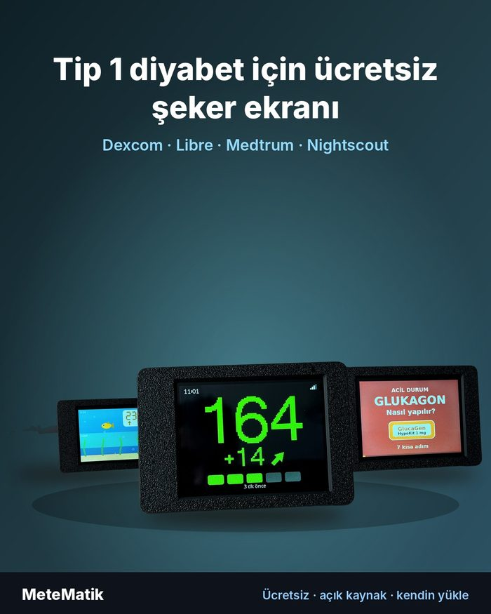
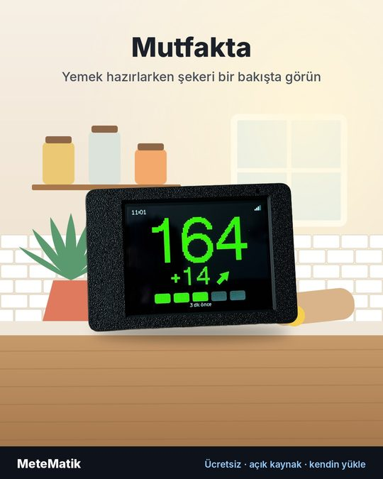
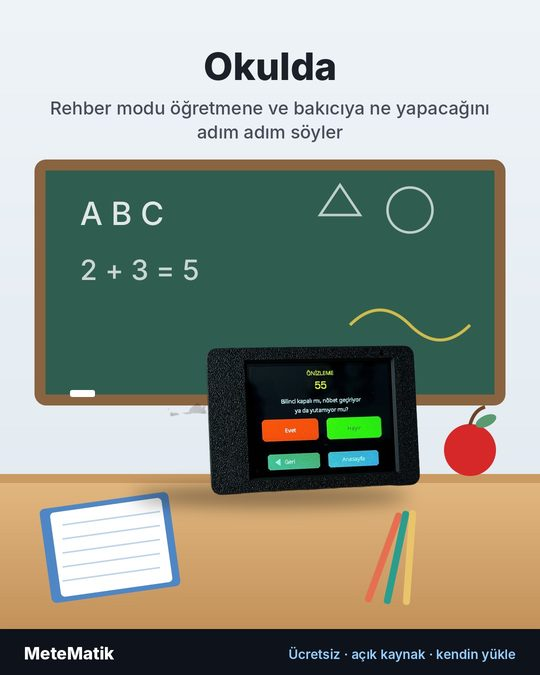
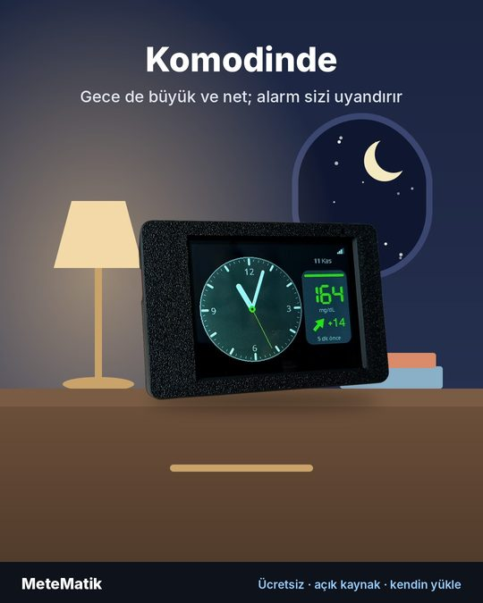
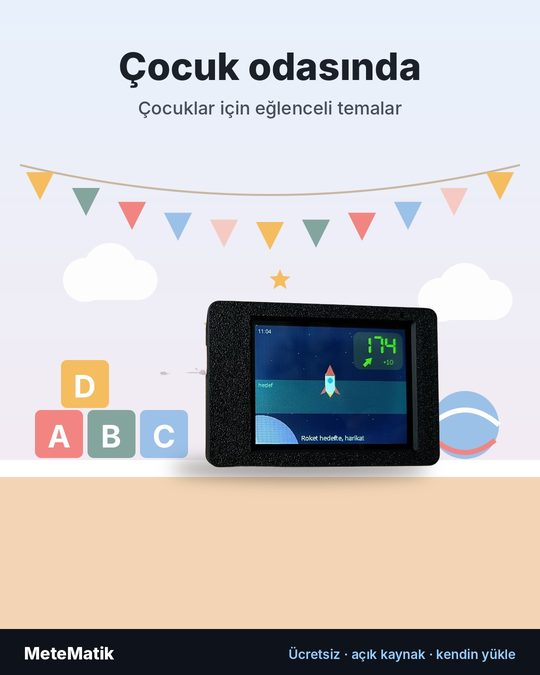

# MeteMatik

**CGM şeker değerleri için ücretsiz, açık kaynaklı bir masa / başucu ekranı.**
Nightscout, Dexcom Share, LibreLinkUp veya Medtrum EasyFollow'dan gelen son şeker değerini, trend okunu ve grafiği 2,8" dokunmatik küçük bir ekranda gösterir; sesli ve görsel alarm verir.

[English → README.md](README.md)

### Kendiniz yapın — ücretsiz

MeteMatik **satılmaz**, hazır cihaz yoktur. Ekran kartını kendiniz alırsınız, kutuyu **istediğiniz renkte, istediğiniz baskıcıya** bastırırsınız ve **yazılımı tarayıcıdan kendiniz yüklersiniz**. Lehim gerekmez.

📘 **[Kurulum rehberi](docs/kurulum-rehberi.md)**: parçalar, baskı, montaj, yükleme, ilk kurulum
📗 **[Kullanım rehberi](docs/kullanim-rehberi.md)**: ekranlar, alarmlar, modlar, aile modu
🎬 Videolar: YouTube **@metematik.t1d**

   

> Oğlum Mete için yaptım. — Burak

---

## ⚠️ Önemli — lütfen okuyun

- **MeteMatik tıbbi cihaz değildir.** Yalnızca bilgi amaçlı, ikincil bir ekrandır.
- **İnsülin ve tedavi kararlarını MeteMatik'e göre vermeyin.** Her zaman resmi CGM cihazınızı veya uygulamanızı esas alın.
- **Asıl CGM / resmi uygulama alarmlarınızı kapatmayın.** MeteMatik'in alarmları ek bir güvencedir, yerine geçmez. İnternet, WiFi veya sunucu sorunlarında veri gecikebilir ya da gelmeyebilir.
- MeteMatik; Dexcom, Abbott, Medtrum, Medtronic ve Nightscout ile **bağlantılı değildir**. Markalar sahiplerine aittir. Bazı kaynaklar resmi olmayan (üçüncü taraf) bağlantılarla okunur; bunlar her an değişebilir veya çalışmayı durdurabilir.
- Glukagon videosu ve Rehber modu adımları bir diyabet hemşiresi tarafından gözden geçirildi; **doktorunuzun talimatlarının yerini tutmaz.**
- Yazılım **hiçbir garanti olmadan** sunulur (bkz. [LICENSE](LICENSE)). Kullanım sorumluluğu kullanıcıya aittir.

---

## Özellikler

- Büyük şeker değeri, trend oku ve delta (5 dakikalık değişim; `*` = veri kesintisinde tahmin, `--` = 15 dakikadan uzun kesinti)
- Grafik (3 / 6 / 12 / 24 saat), günlük istatistik (hedef aralıkta geçen süre), sensör / set süresi
- Alarmlar: kritik düşük, düşük, yüksek, çok yüksek, hızlı düşüş / yükseliş, veri yok — erteleme, görsel (yanıp sönen) alarm, her alarm için ses aç/kapa
- **Aile modu:** tek cihazda **en fazla 3 kişi**; her kişinin adı, kaynağı ve eşikleri ayrı. Ana ekran *sırayla* (15 sn) veya *bölünmüş* (hepsi birlikte). Alarmdaki kişi ekrana gelir.
- Öğretmen / bakıcı için **Rehber modu:** tehlikeli değerde *Dikkat* butonu çıkar, yapılacakları adım adım gösterir; glukagon videosu cihazın içinde
- Gece modu, okul modu, rahatsız etme (şeker hedefteyken ekran kapanır, alarmda veya parmak şıklatınca açılır)
- Çok sayıda ana ekran teması, çocuk temaları, fotoğraf çerçevesi
- Karbonhidrat notu hesaplayıcı, yemek zamanlayıcısı
- Ayarlar hem cihazdan **hem de** telefondan tarayıcıyla (aynı WiFi)
- **9 dil:** Türkçe, English, Español, Português, Français, Deutsch, Italiano, Русский, Bahasa Indonesia
- Renk dostu mod, mg/dL veya mmol/L

## Veri kaynakları

| Kaynak | Gerekenler |
|---|---|
| **Nightscout** | Site adresi (https://…), site herkese açık değilse okuma izinli erişim anahtarı |
| **Dexcom** (G6 / G7 / ONE+) | Kendi Dexcom hesabınız; uygulamada *Paylaşım (Share)* açık ve en az bir takipçi ekli |
| **FreeStyle Libre** (LibreLinkUp) | Daveti kabul etmiş bir LibreLinkUp *takipçi* hesabı |
| **Medtrum** (EasyFollow) | EasyFollow takipçi hesabı (Avrupa sunucusu) |
| **Medtronic** | Nightscout üzerinden (örneğin nightscout-connect ile) |

Adım adım: [docs/kaynaklar.md](docs/kaynaklar.md)

## Donanım

| Parça | Not |
|---|---|
| **Elecrow CrowPanel Advance 2.8" ESP32-S3** (HMI ekran, V1.2) | Dokunmatik, WiFi, buzzer — lehim gerekmez |
| USB-C kablo + 5 V USB adaptör | Cihaz prize takılı çalışır |
| 3D baskı kutu (isteğe bağlı) | Dosyalar [crown/case](crown/case) — 4 adet M3×16 vida (DIN 7985) |

**Ekranı nereden alabilirim:** Türkiye'de [Robocombo](https://robocombo.com/crowpanel-advance-2-8-esp32-s3-hmi-dokunmatik-ekr-4817). Stokta yoksa üreticinin kendi sitesinden: [Elecrow – CrowPanel Advance 2.8" HMI ESP32-S3](https://www.elecrow.com/crowpanel-advance-2-8-hmi-esp32-ai-display-320x240-artificial-ips-intelligent-touchscreen.html) (yurt dışından gönderir; gümrük ve kargo ücreti çıkabilir). Normal **Advance 2.8"** modelini alın (Meshtastic sürümü de çalışır ama ek telsiz modülü yüzünden daha pahalıdır). MeteMatik bu satıcılarla bağlantılı değildir.

Pilli sürüm (pil ölçer, anahtar, lehim gerektirir) ayrı bir "ileri seviye" rehberi olarak eklenecek.

## Yazılımı yükleme

### Yol A — tarayıcıdan (en kolayı)
Bilgisayarda Chrome veya Edge ile **[yükleme sayfasını](https://metematik-t1d.github.io/metematik/install/)** açın, kartın **USB** girişini veri taşıyan bir kabloyla bağlayın ve *Yükle*'ye basın. Program kurmak gerekmez. (Sayfanın kaynağı: [install/](install/).)

### Yol B — Arduino IDE
1. **Arduino IDE 2**'yi kurun; *Kart Yöneticisi*'nden **esp32 by Espressif Systems** (3.3.x) kurun.
2. *Kütüphane Yöneticisi*'nden: **LovyanGFX** (lovyan03), **WiFiManager** (tzapu), **ArduinoJson** (Benoit Blanchon).
   Denenen sürümler: esp32 3.3.11, LovyanGFX 1.2.32, WiFiManager 2.0.17, ArduinoJson 7.4.3.
3. `crown/firmware/metematik-bt/metematik-bt.ino` dosyasını açın (klasördeki bütün dosyalar birlikte durmalı).
4. *Araçlar* menüsü:
   - Kart: **ESP32S3 Dev Module**
   - USB CDC On Boot: **Disabled**
   - Flash Size: **16MB (128Mb)**
   - Partition Scheme: **Custom** (klasördeki `partitions.csv` kullanılır)
   - PSRAM: **OPI PSRAM**
   - Upload Speed: **921600**
5. Kartın **USB** yazan girişini bağlayın, portu seçin, *Yükle*'ye basın. Cihaz kendiliğinden yeniden başlar; başlamazsa USB kablosunu çıkarıp tekrar takın.

Sonraki güncellemeler cihazın web sayfasından (*Yazılım güncelleme*) WiFi ile yüklenebilir.

## İlk açılış

1. **Dili** seçin.
2. **WiFi kurulumu** ekranında iki QR vardır. 1. QR'ı telefonla okutup cihazın kurulum ağına bağlanın; sayfa açılmazsa 2. QR'ı okutun.
3. Ev WiFi'nizi seçin ve **bir** veri kaynağını doldurun. Kaydedin.
4. Cihaz yeniden başlar ve şekeri gösterir. Diğer her şey cihazdan (*Ayarlar*) veya telefondan değiştirilebilir: *Ayarlar → QR / Web*'deki QR'ı okutun.

## Aile modu

Cihazın web sayfasında **Aile modu** kartını (*Güvenlik*'in üstünde) **Açık** yapın, 2 veya 3 kişi seçip adlarını yazın. Sonra sayfanın üstünden her kişiyi seçip kaynağını ve eşiklerini girin. Cihazda: *Modlar → Aile modu*.

## Çeviriler

Metinler `crown/firmware/metematik-bt/lang/` klasöründedir. Ana dili konuşanların düzeltmeleri — özellikle tıbbi metinlerde — çok değerli. Bir "issue" açın veya bize yazın.

## Lisans

Telif hakkı © 2026 Burak. **GNU Genel Kamu Lisansı v3.0 (GPL-3.0)** — bkz. [LICENSE](LICENSE).
MeteMatik'i kullanabilir, inceleyebilir, paylaşabilir ve değiştirebilirsiniz. Değiştirilmiş bir sürümü paylaşırsanız o da GPL-3.0 ile açık kaynak olmalıdır.

Üçüncü taraf parçalar: Noto Sans yazı tipi (SIL Open Font License 1.1), LovyanGFX (FreeBSD), WiFiManager (MIT), ArduinoJson (MIT), QRCode — Richard Moore (MIT), ESP32 Arduino çekirdeği (LGPL 2.1 / Apache 2.0).

## İletişim

- E-posta: **metematik.t1d@gmail.com**
- YouTube: **@metematik.t1d** (yapım, kurulum ve kullanım videoları)
