# MeteMatik kullanım rehberi

[English → user-guide.md](user-guide.md) · [← Kurulum rehberi](kurulum-rehberi.md)

> ⚠️ MeteMatik tıbbi cihaz değildir, sadece bilgi verir. İnsülin ya da tedavi kararı için kullanmayın. Resmi CGM uygulamanızı esas alın ve asıl CGM alarmlarınızı kapatmayın.

🎬 Video: https://youtu.be/sWX9ir8FWBQ

## Ana ekran

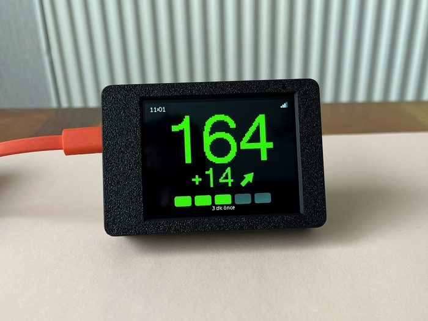

- **Büyük sayı:** son şeker değeri (mg/dL ya da mmol/L).
- **Ok:** yön (yükseliyor, düşüyor, sabit).
- **Delta:** son 5 dakikadaki değişim. Yanında `*` varsa veride kesinti olmuştur ve değişim 5 dakikaya çevrilerek tahmin edilmiştir. `--` ise 15 dakikadan uzun bir kesinti olduğunu, değişimin bilinmediğini gösterir.
- **Alttaki çubuklar:** ölçümün kaç dakika önce geldiği.

## Gezinme

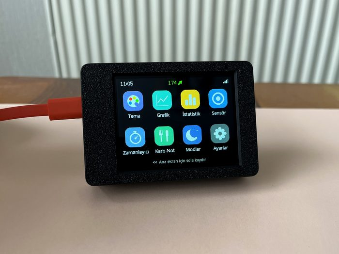

- Ana ekranda parmağınızı **sola kaydırın**: uygulamalar açılır.
- **Sağa kaydırın** ya da **BOOT** tuşuna kısa basın: bir geri.
- Uygulamalar: **Tema, Grafik, İstatistik, Sensör, Zamanlayıcı, Karb-Not, Modlar, Ayarlar**.
- Listeler parmakla yukarı aşağı kaydırılır, dokununca açılır. Bir ayarı değiştirdikten sonra sağ üstteki **Kaydet**'e basın. Kaydetmeden *Geri*'ye basarsanız cihaz sorar.
- **(i)** işaretine dokunursanız o özelliğin ne işe yaradığı yazar.

## Temalar

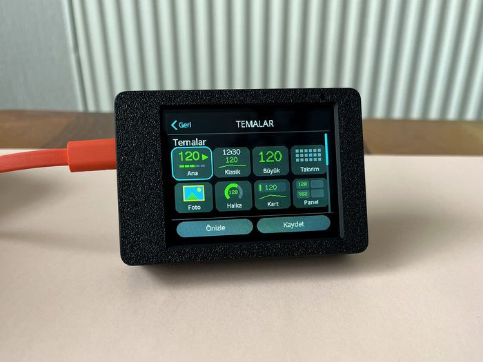 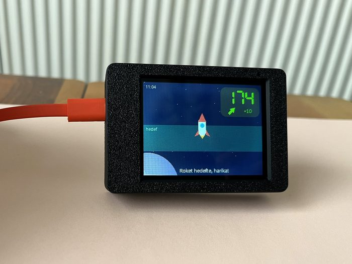

- **Tema** uygulamasından ana ekranın görünümünü seçin: büyük rakam, saat, takvim ve çocuklar için roket, balon, balık, gülen yüz gibi temalar.
- Kısayol: ana ekranda **parmağınızı basılı tutun**, tema seçimi açılır.
- *Ayarlar → Sayfaları düzenle*: istediğiniz özellikler (2. tema, grafik, istatistik, sensör…) ana ekrana ayrı sayfa olarak eklenir. Sayfalar arasında kaydırarak geçersiniz. 2. ya da 3. sayfadayken basılı tutarsanız o sayfanın teması değişir.

## Grafik, istatistik, sensör

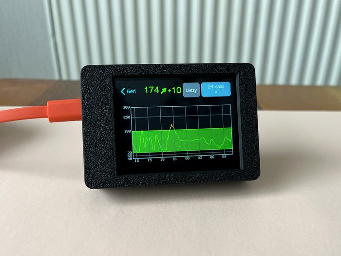 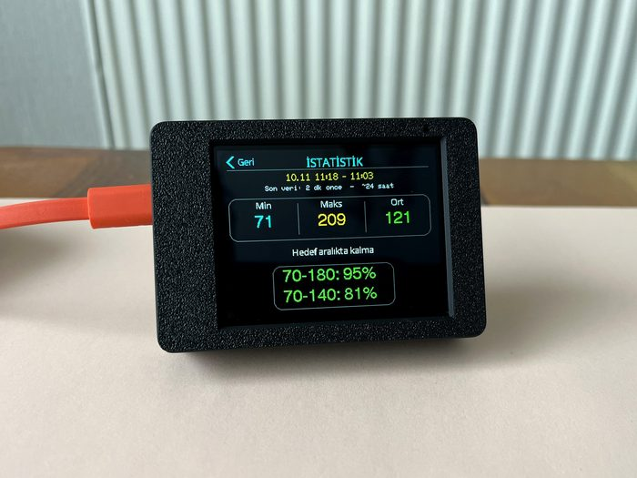 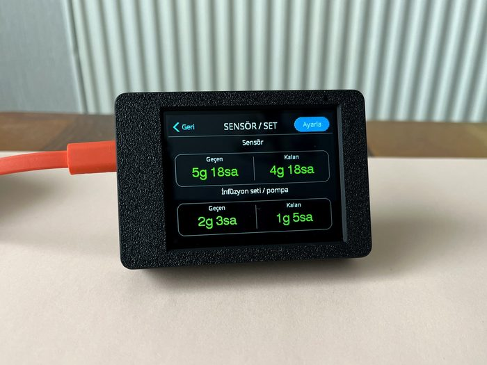

- **Grafik:** son 3 / 6 / 12 / 24 saat.
- **İstatistik:** en düşük, en yüksek, ortalama ve hedef aralıkta kalma süresi.
- **Sensör:** sensörün ve setin (pompa kanülü) ne kadar süredir takılı olduğu. Süre dolmaya 12 saat, 3 saat, 1 saat ve 15 dakika kala kısa bir uyarı çıkar. Dexcom ve Libre kullanıyorsanız takma zamanını buradan girin. Pompa kullanmıyorsanız set takibini kapatabilirsiniz.

## Alarmlar

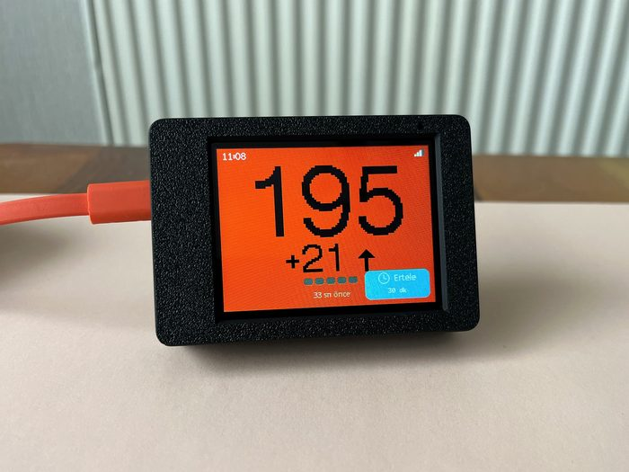

- *Ayarlar → Hedefler:* kritik düşük, düşük, yüksek ve çok yüksek eşikleri ile bunların sesleri.
- *Ayarlar → Alarmlar:* hızlı düşüş/yükseliş (çift ok) alarmı, veri yok alarmı, görsel (yanıp sönen) alarm ve erteleme süresi.
- Alarm çaldığında **Ertele**'ye basın: 15, 30 ya da 60 dakika susar.
- Çift ok alarmı yalnız Nightscout ve Dexcom'da çalışır, çünkü LibreLinkUp bu bilgiyi vermez.

## Modlar

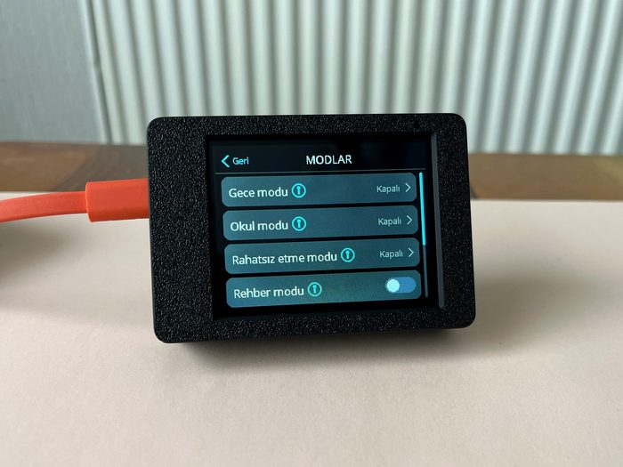

- **Gece modu / Okul modu:** seçtiğiniz saatlerde ses ve parlaklık kendiliğinden değişir. Saate dokunarak istediğiniz saati yazabilirsiniz.
- **Rahatsız etme:** şeker hedefteyken ekran kapanır. Alarm olursa ya da parmak şıklatırsanız açılır.
- **Rehber modu** (varsayılan olarak kapalı): açıkken şeker tehlikeli aralığa girdiğinde ana ekranda **Dikkat** butonu çıkar. Butona basan kişiye (öğretmen, bakıcı, aile yakını) ne yapması gerektiği adım adım gösterilir.

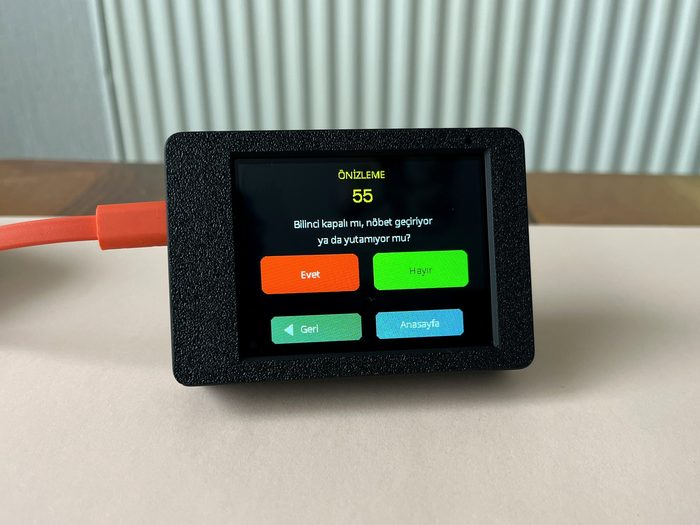 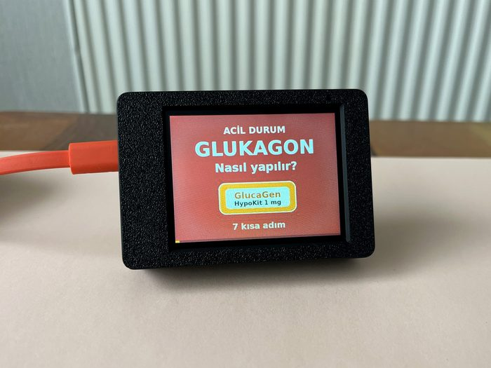

Rehber adımlarına ve glukagon videosuna bir diyabet hemşiresi göz attı. Bu adımlar doktorunuzun talimatlarının yerini tutmaz.

## Aile modu (3 kişiye kadar)

1. Telefonla cihazın web sayfasını açın (*Ayarlar → QR / Web*, QR'ı okutun).
2. **Aile modu** kartını açın, 2 ya da 3 kişi seçin ve isimlerini yazın.
3. Sayfanın üstünden her kişiyi seçip veri kaynağını ve eşiklerini girin.
4. Cihazda: *Modlar → Aile modu*. Ana ekran **Sırayla** (her kişi 15 saniye) ya da **Bölünmüş** (hepsi birlikte) olarak gösterilir.

Başlıktaki isme dokunarak kişi değiştirebilirsiniz. Alarmdaki kişi kendiliğinden ekrana gelir.

## Telefondan ayar

Aynı Wi-Fi'deki bir telefonla *Ayarlar → QR / Web* ekranındaki QR'ı okutun. Bütün ayarları, veri kaynağını ve aile modunu telefondan değiştirebilirsiniz. Sayfa cihazın üzerinde ekrana yazılan şifreyle korunur. Bu şifreyi kimseyle paylaşmayın.

## Ekran ve dil

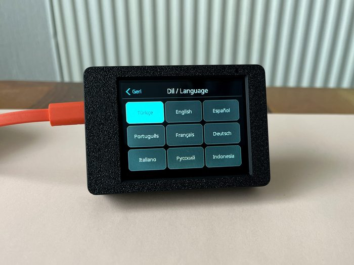

*Ayarlar → Ekran/Dil ayarları:* ekran yönü, **Renk dostu mod** (renk körlüğü için) ve dil. Desteklenen diller: Türkçe, English, Español, Português, Français, Deutsch, Italiano, Русский, Bahasa Indonesia.

## Faydalı bilgiler

- **BOOT tuşuna 2 saniye basmak** Wi-Fi ve kaynak kurulumunu yeniden açar.
- Cihaz bilgilerinizi hiçbir yere göndermez. Yalnız seçtiğiniz CGM kaynağına bağlanır.
- Güncelleme: [kurulum rehberi, 7. adım](kurulum-rehberi.md#7-güncelleme).
