# MeteMatik kurulum rehberi

[English → setup-guide.md](setup-guide.md) · [Kullanım rehberi →](kullanim-rehberi.md)

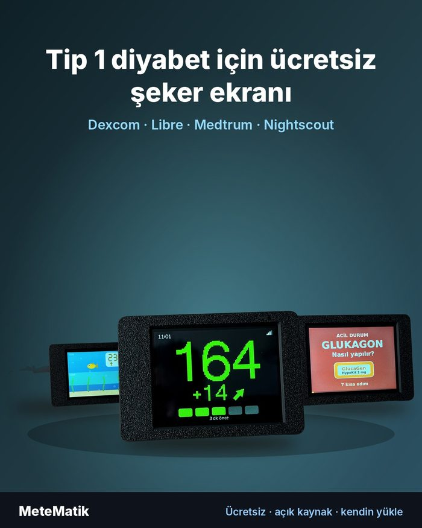

**MeteMatik ücretsizdir ve satılmaz. Hazır bir cihaz yoktur.** Cihazı kendiniz hazırlarsınız:

1. Ekran kartını satın alırsınız.
2. Kutuyu istediğiniz renkte, istediğiniz baskıcıya bastırırsınız.
3. Kartı kutuya takarsınız. Lehim gerekmez, 2 dakika sürer.
4. Yazılımı bilgisayardan, tarayıcıyla kendiniz yüklersiniz. Program kurmanız gerekmez.
5. Telefonla Wi-Fi ve CGM hesabınızı girersiniz.

Videolu anlatım: YouTube **@metematik.t1d**

> ⚠️ MeteMatik tıbbi cihaz değildir. Tedavi kararları için resmi CGM uygulamanızı esas alın ve asıl CGM alarmlarınızı kapatmayın.

<br clear="right">

---

## 1. Gerekenler

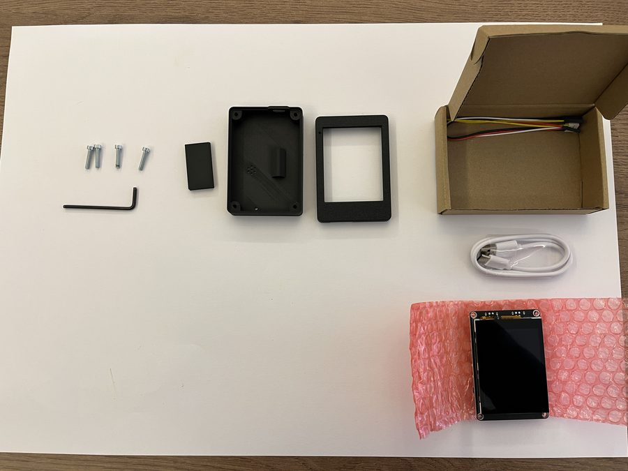

| Parça | Açıklama |
|---|---|
| **Elecrow CrowPanel Advance 2.8" ESP32-S3** (V1.2) | Dokunmatik ekranlı kart. Lehim gerekmez. |
| 3D baskı kutu | 3 parça: ön katman, arka katman, küçük ayak. Dosyalar: [crown/case](../crown/case) |
| 4 adet M3×16 vida | Silindir ya da yuvarlak başlı (DIN 7985 yıldız veya ISO 7380 alyan) |
| Tornavida ya da alyan anahtarı | Vidaya uygun olanı |
| USB-C kablo | **Veri taşıyan** kablo olmalı (yalnız şarj eden kablolar çalışmaz) |
| 5 V USB adaptör | Herhangi bir telefon şarj adaptörü. Cihaz hep prizde durur. |

Yazılımı yüklemek için bir de **bilgisayar** (Windows, Mac veya Linux) ve **Chrome ya da Edge** tarayıcı gerekir. Kurulum için telefon yeterli değildir.

## 2. Ekran kartını satın alın

- **Elecrow resmi mağaza** (dünyaya gönderir): [CrowPanel Advance 2.8" HMI ESP32-S3](https://www.elecrow.com/crowpanel-advance-2-8-hmi-esp32-ai-display-320x240-artificial-ips-intelligent-touchscreen.html)
- **Türkiye:** [Robocombo](https://robocombo.com/crowpanel-advance-2-8-esp32-s3-hmi-dokunmatik-ekr-4817)

Normal **Advance 2.8"** sürümünü alın. Meshtastic sürümü de çalışır ama fazladan telsiz modülü olduğu için daha pahalıdır. MeteMatik bu mağazalarla bağlantılı değildir.

## 3. Kutuyu bastırın

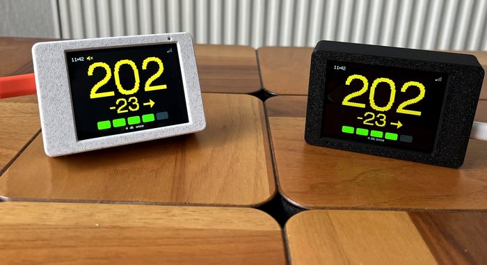

Kutu dosyaları ücretsizdir: [crown/case](../crown/case). Üç STL dosyasını indirip kendi yazıcınızda basabilir ya da **herhangi bir 3D baskı hizmetine** gönderebilirsiniz. Renk tamamen size kalmış; ön ve arka katmanı farklı renkte bastırmak da güzel olur.

**Baskıcıya gönderebileceğiniz mesaj:**

```
Merhaba, ekteki 3 STL dosyasından birer adet baskı istiyorum.
Malzeme: PLA veya PETG
Renk: (istediğiniz renk)
Katman: 0,2 mm, doluluk %20
Ön katman yüzü tablaya gelecek şekilde, arka katman açık tarafı tablaya gelecek şekilde basılmalı.
Gerekiyorsa destek ekleyebilirsiniz.
```

| Dosya | Parça |
|---|---|
| `MeteMatik_CP28_v3.4_front.stl` | Ön katman (ekran penceresi) |
| `MeteMatik_CP28_v3.4_back.stl` | Arka katman (32° eğimli ayak, USB girişi) |
| `MeteMatik_CP28_v3.4_foot.stl` | Küçük ayak |

## 4. Kartı kutuya takın

| | |
|---|---|
| 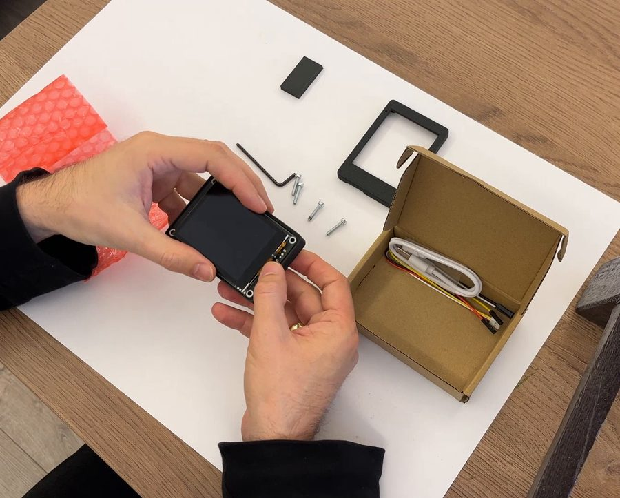 | **1.** Kartı paketinden çıkarın, ekran yüzü aşağı bakacak şekilde ön katmana yerleştirin. |
| 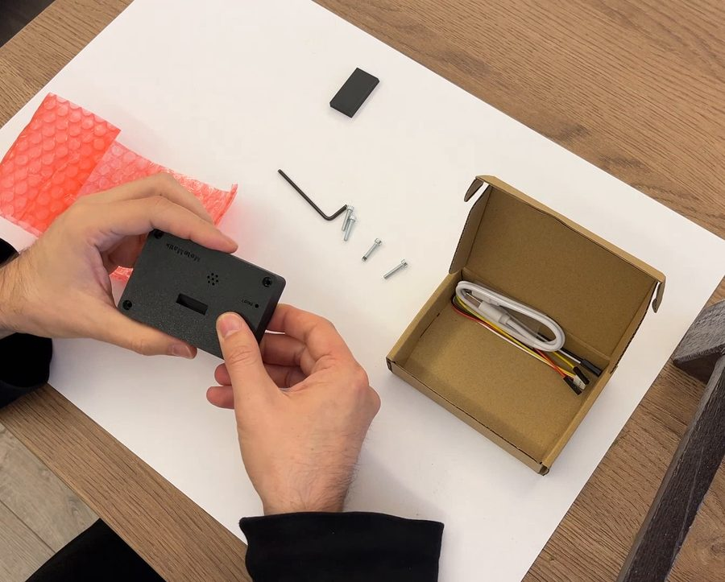 | **2.** Arka katmanı kapatın. **USB** yazan giriş kutudaki açıklığa denk gelmeli. |
| 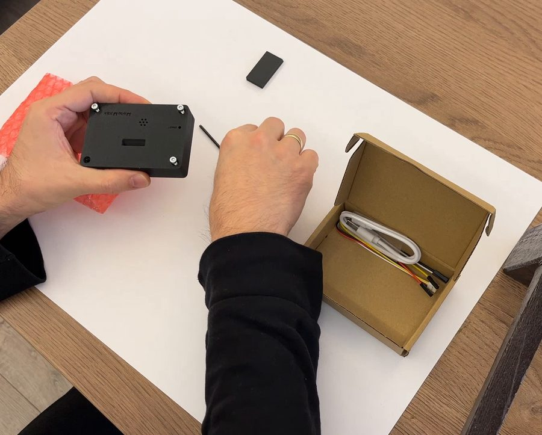 | **3.** 4 vidayı arkadan takıp sıkın. Fazla sıkmayın. |
| 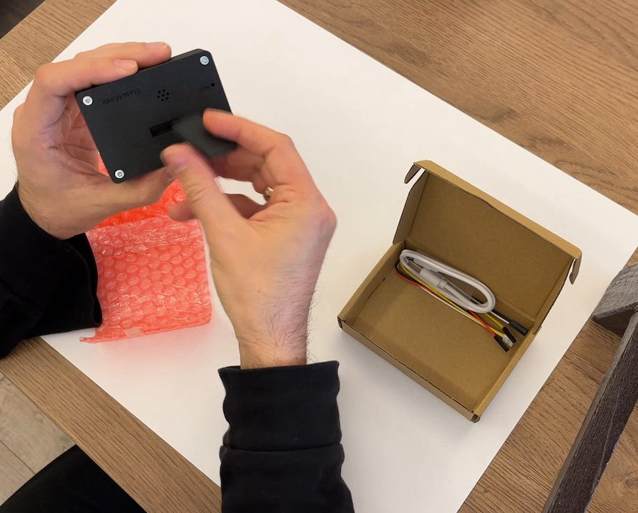 | **4.** Küçük ayağı arkadaki yerine takın. |

RESET tuşu kutunun içinde kalır. BOOT tuşuna bir ataçla ulaşılabilir.

## 5. Yazılımı yükleyin

Bilgisayarda **Chrome** ya da **Edge** ile kurulum sayfasını açın:
**https://metematik-t1d.github.io/metematik/install/**

| | |
|---|---|
| 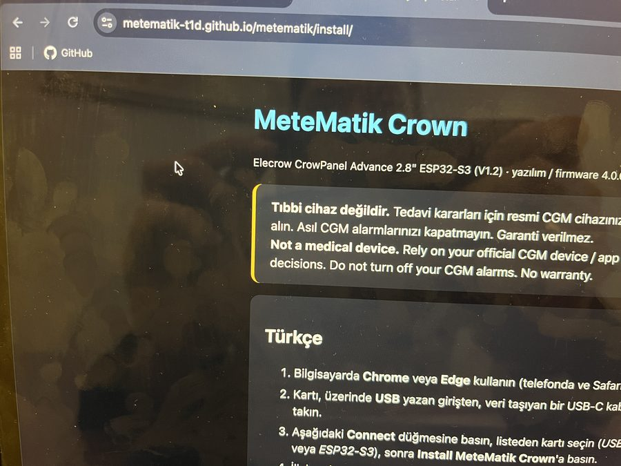 | **1.** Kurulum sayfasını açın. Safari'de ve telefonda çalışmaz. |
| 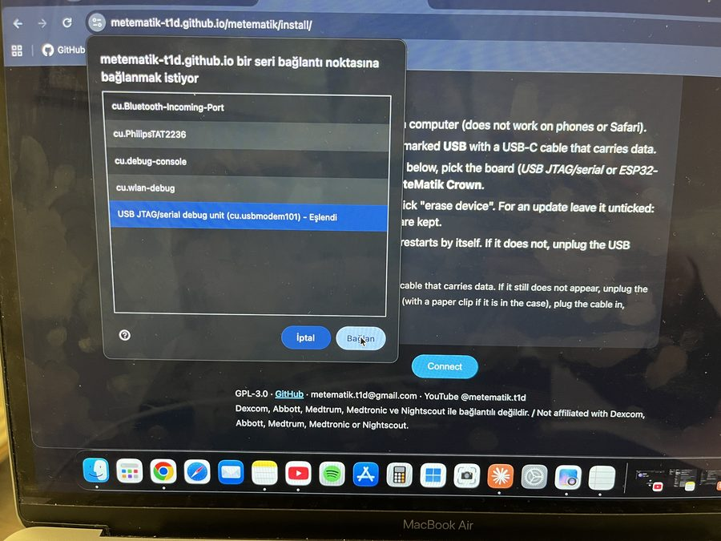 | **2.** Kartı **USB** yazan girişinden bilgisayara bağlayın. **Connect**'e basın, listeden **USB JTAG/serial** portunu seçin ve **Bağlan**'a basın. |
| 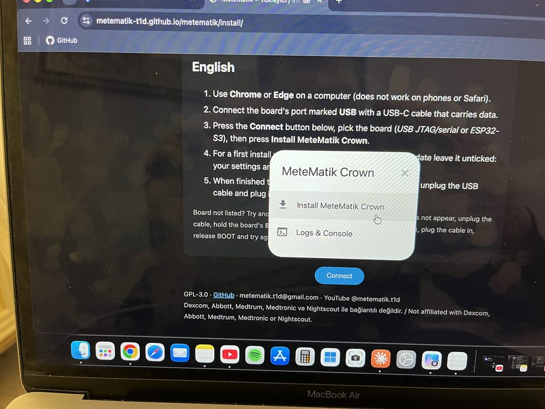 | **3.** **Install MeteMatik Crown**'a basın. |
| 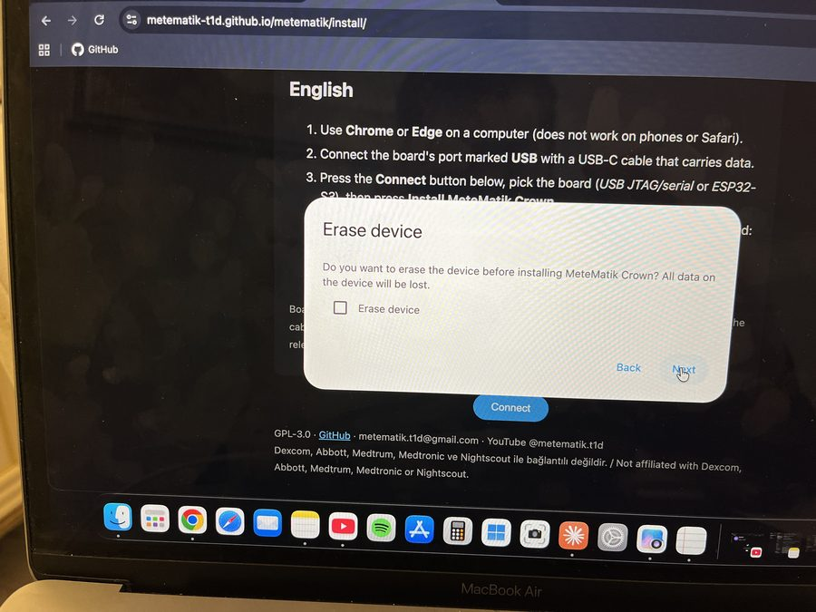 | **4.** İlk kurulumda **Erase device** kutusunu işaretleyin. Güncelleme yaparken boş bırakın, ayarlarınız silinmez. Sonra **Install** ile onaylayın. |
| 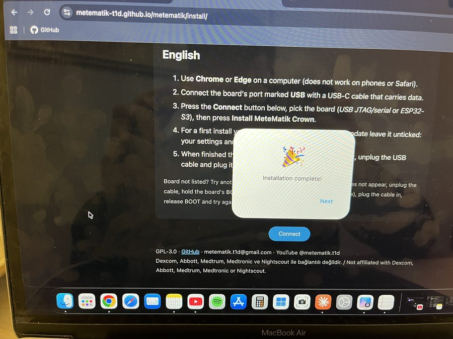 | **5.** Yükleme birkaç dakika sürer. **Installation complete** yazınca cihaz kendiliğinden yeniden başlar. Başlamazsa USB kablosunu çıkarıp takın. |

## 6. İlk kurulum (telefonla)

Cihazı USB adaptörle prize takın.

| | |
|---|---|
| 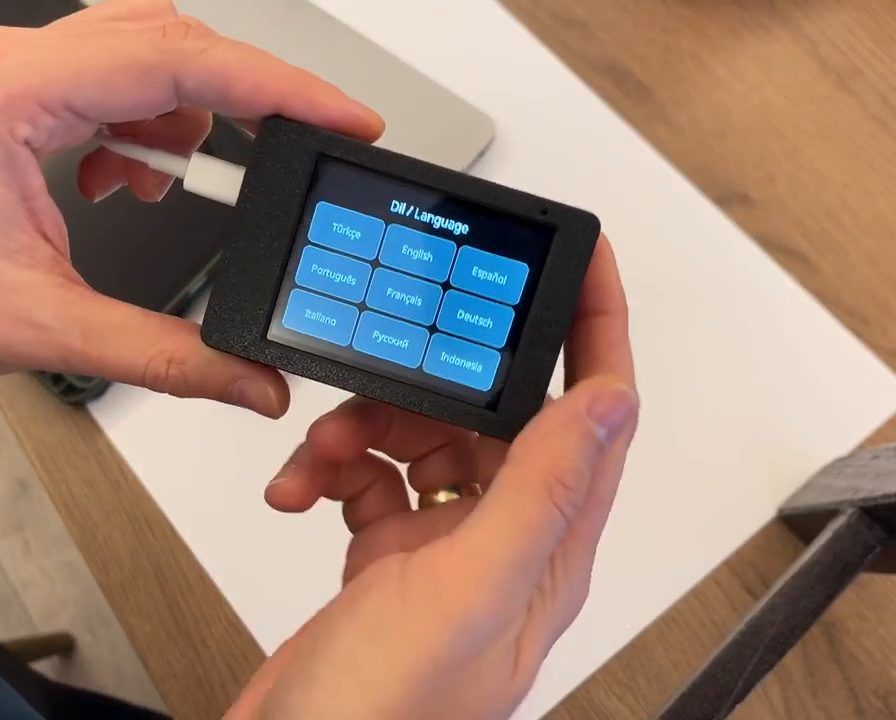 | **1.** Dili seçin. |
| 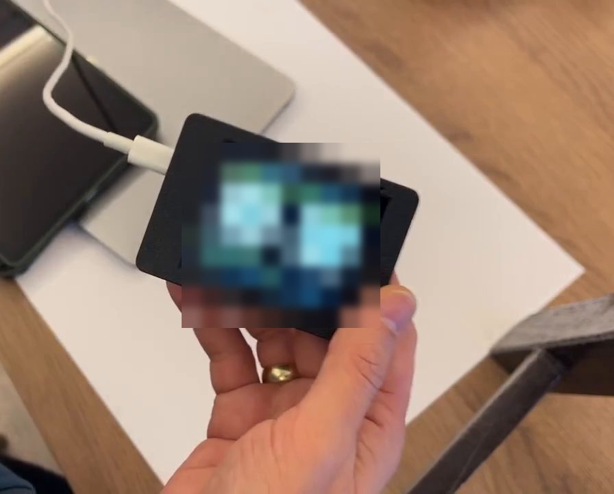 | **2.** Ekranda iki QR kod çıkar. **1. QR**'ı telefonun kamerasıyla okutun; telefon cihazın kurulum ağına bağlanır. Kurulum sayfası kendiliğinden açılmazsa **2. QR**'ı okutun. |
| 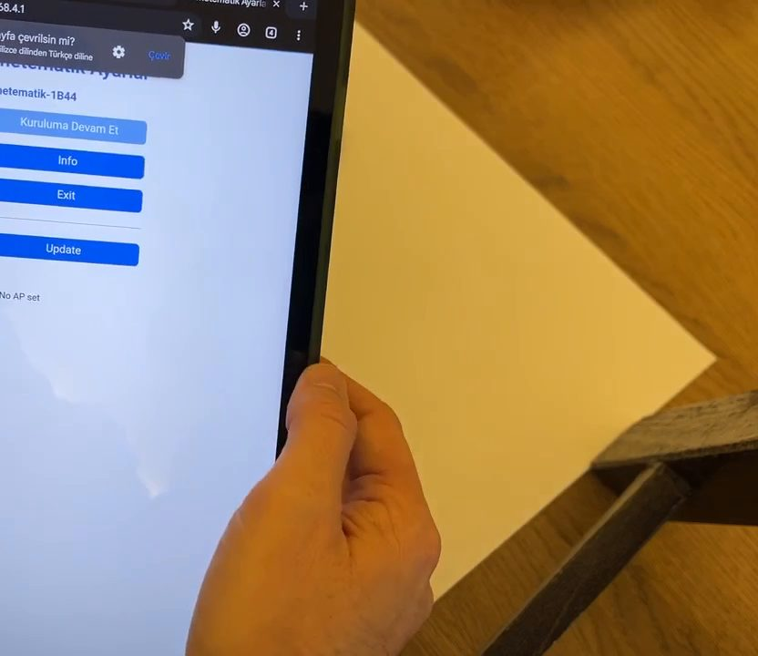 | **3.** Sayfada ev Wi-Fi ağınızı seçip şifresini girin. Ardından **bir** veri kaynağının bilgilerini doldurun ve kaydedin. |

Cihaz yeniden başlar, önemli uyarıyı gösterir ve ardından şekeriniz ekranda görünür.

**Veri kaynakları** (ayrıntılar: [sources.md](sources.md)):

| Kaynak | Gerekenler |
|---|---|
| Dexcom (G6 / G7 / ONE+) | Sensörün bağlı olduğu **kendi** Dexcom hesabınız (Follow hesabı değil). Dexcom uygulamasında **Paylaşım (Share)** açık olmalı ve en az bir takipçi ekli olmalı. Telefonla kayıtlıysanız numarayı `+905…` biçiminde yazın. Sunucu: **ous** |
| FreeStyle Libre | Daveti kabul etmiş bir **LibreLinkUp** takipçi hesabı |
| Medtrum | Bir **EasyFollow** takipçi hesabı |
| Nightscout | Site adresi (https://…) ve gerekiyorsa okuma token'ı |

Wi-Fi hakkında: Cihaz yalnız **2,4 GHz** ağlara bağlanır. Telefonunuzun hotspot'unu kullanacaksanız kurulum sırasında hotspot'u kapatın, cihazın ağına bağlanıp bilgileri girin, sonra hotspot'u yeniden açın.

## 7. Güncelleme

İki yolu var:

- **Kurulum sayfasından:** 5. adımı tekrarlayın, ama **Erase device kutusunu işaretlemeyin**. Ayarlarınız korunur.
- **Kablosuz:** Aynı Wi-Fi'deki bir telefon ya da bilgisayarla cihazın web sayfasını açın (*Ayarlar → QR / Web*), *Yazılım güncelleme* bölümünden `.bin` dosyasını yükleyin.

## 8. Sorun giderme

| Sorun | Çözüm |
|---|---|
| Port listesinde kart yok | Başka bir USB-C kablo deneyin (veri taşıyan). Olmazsa BOOT tuşunu ataçla basılı tutup kabloyu takın, sonra bırakın. |
| Kurulum sayfası açılmıyor | Telefonun cihazın ağına bağlı olduğundan emin olun ve 2. QR'ı okutun. |
| Wi-Fi'ye bağlanmıyor | 2,4 GHz ağ seçin ve şifreyi kontrol edin. BOOT tuşuna 2 saniye basmak Wi-Fi kurulumunu yeniden açar. |
| "Veri gelmiyor" | Kaynak bilgilerini kontrol edin. Dexcom'da Share açık mı, Libre'de davet kabul edildi mi? Ekrandaki hata yazısı sebebi söyler. |

Takıldığınız bir yer olursa: **metematik.t1d@gmail.com** ya da GitHub'da bir *Issue* açın.
