# MeteMatik setup guide

[Türkçe → kurulum-rehberi.md](kurulum-rehberi.md) · [User guide →](user-guide.md)

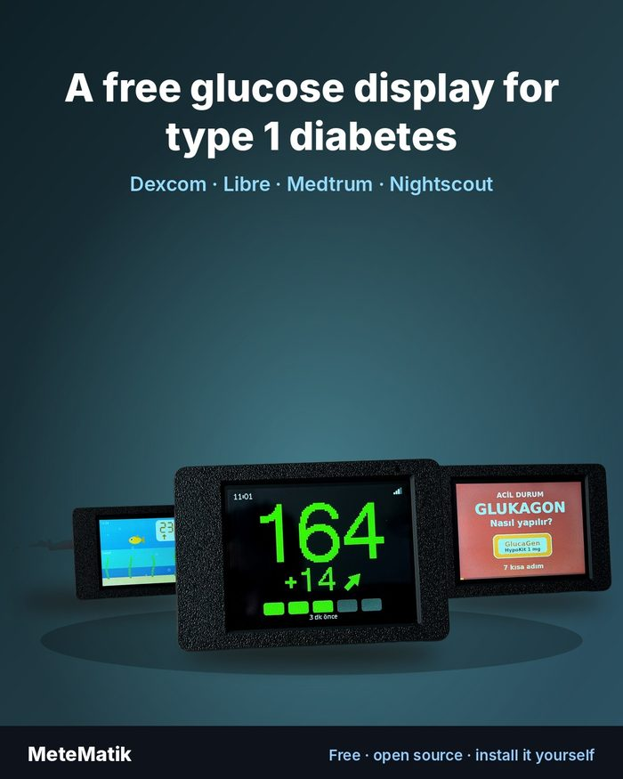

**MeteMatik is free and is not sold. There is no ready-made device.** You build it yourself:

1. Buy the display board.
2. Have the case printed in any color, by any 3D-print service you like.
3. Fit the board into the case. No soldering, about 2 minutes.
4. Install the software yourself from a computer, in your browser. Nothing to download.
5. Enter your Wi-Fi and CGM account with your phone.

Video walkthroughs: YouTube **@metematik.t1d**

> ⚠️ MeteMatik is not a medical device. Rely on your official CGM app for treatment decisions and keep your CGM alarms on.

<br clear="right">

---

## 1. What you need

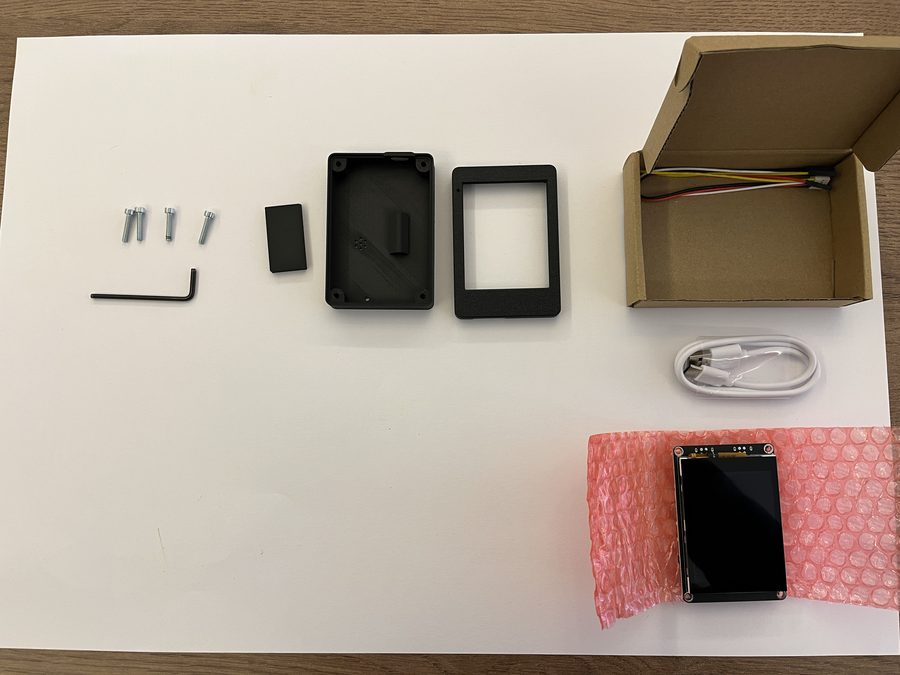

| Part | Notes |
|---|---|
| **Elecrow CrowPanel Advance 2.8" ESP32-S3** (V1.2) | Touchscreen board. No soldering. |
| 3D-printed case | 3 parts: front layer, back layer, small foot. Files: [crown/case](../crown/case) |
| 4 × M3×16 screws | Cheese or button head (DIN 7985 Phillips or ISO 7380 hex) |
| Screwdriver or hex key | To match the screws |
| USB-C cable | Must **carry data** (charge-only cables do not work) |
| 5 V USB charger | Any phone charger. The device stays plugged in. |

To install the software you also need a **computer** (Windows, Mac or Linux) with **Chrome or Edge**. A phone is not enough for this step.

## 2. Buy the display board

- **Elecrow official store** (ships worldwide): [CrowPanel Advance 2.8" HMI ESP32-S3](https://www.elecrow.com/crowpanel-advance-2-8-hmi-esp32-ai-display-320x240-artificial-ips-intelligent-touchscreen.html)
- **Turkey:** [Robocombo](https://robocombo.com/crowpanel-advance-2-8-esp32-s3-hmi-dokunmatik-ekr-4817)

Get the regular **Advance 2.8"**. The Meshtastic version also works but costs more because of its extra radio module. MeteMatik is not affiliated with these shops.

## 3. Print the case

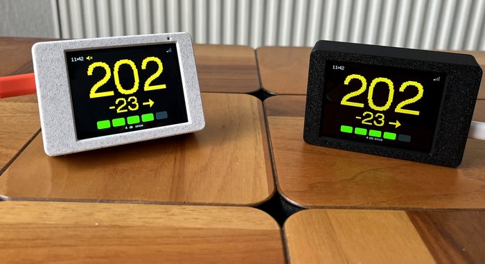

The case files are free: [crown/case](../crown/case). Print the three STL files on your own printer or send them to **any 3D printing service**. Pick any color; front and back in different colors look nice too.

**Message you can send to a print service:**

```
Hello, I'd like one print of each of the 3 attached STL files.
Material: PLA or PETG
Color: (your color)
Layer height 0.2 mm, infill 20%
Print the front layer face-down and the back layer with its open side on the bed.
Add supports if needed.
```

| File | Part |
|---|---|
| `MeteMatik_CP28_v3.4_front.stl` | Front layer (screen window) |
| `MeteMatik_CP28_v3.4_back.stl` | Back layer (built-in 32° stand, USB opening) |
| `MeteMatik_CP28_v3.4_foot.stl` | Small foot |

## 4. Assemble

| | |
|---|---|
| 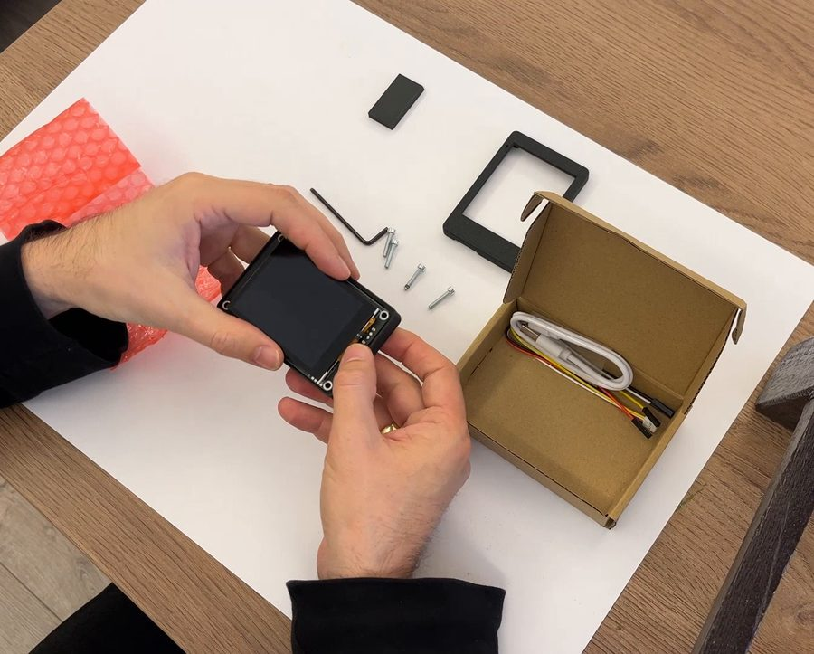 | **1.** Unpack the board and place it screen-down in the front layer. |
| 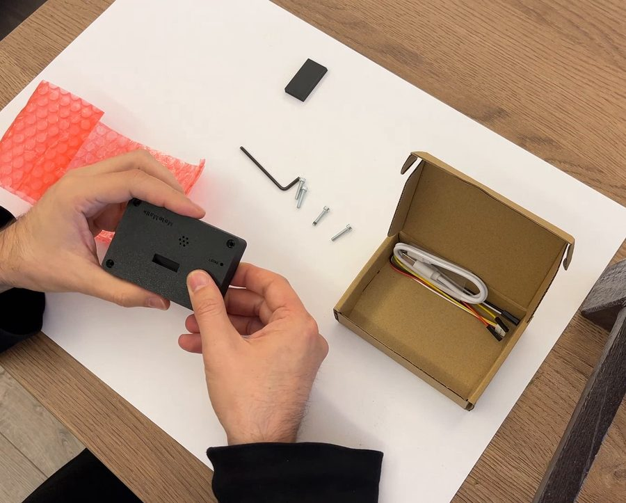 | **2.** Close it with the back layer. The port marked **USB** must line up with the opening. |
| 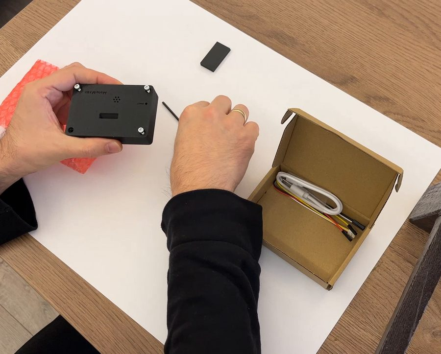 | **3.** Insert the 4 screws from the back and tighten. Do not overtighten. |
| 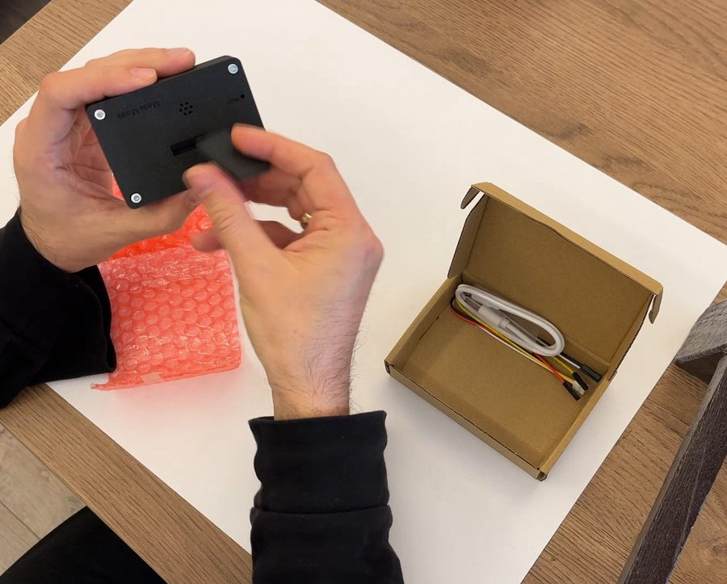 | **4.** Fit the small foot at the back. |

The RESET button stays covered. BOOT can be reached with a paper clip.

## 5. Install the software

Open the install page on a computer in **Chrome** or **Edge**:
**https://metematik-t1d.github.io/metematik/install/**

| | |
|---|---|
| 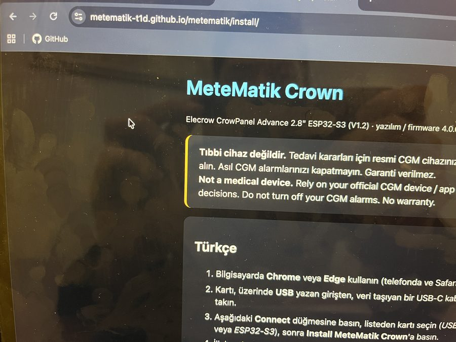 | **1.** Open the install page. It does not work in Safari or on phones. |
| 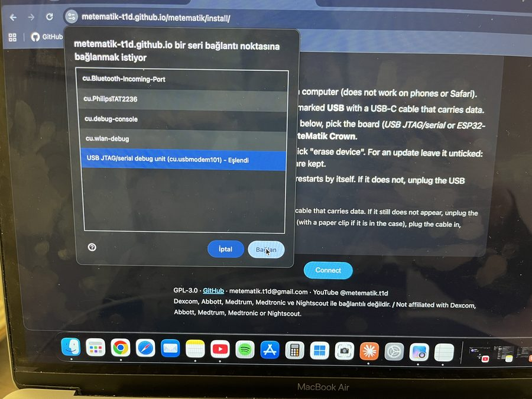 | **2.** Connect the board's port marked **USB** to the computer. Press **Connect**, pick the **USB JTAG/serial** port and confirm. |
| 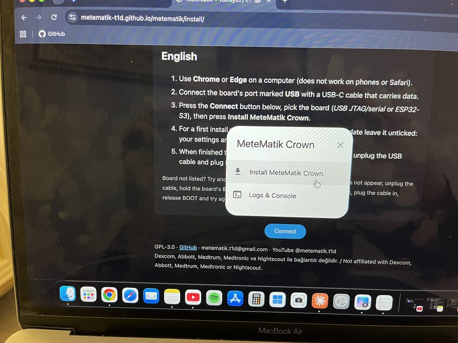 | **3.** Press **Install MeteMatik Crown**. |
| 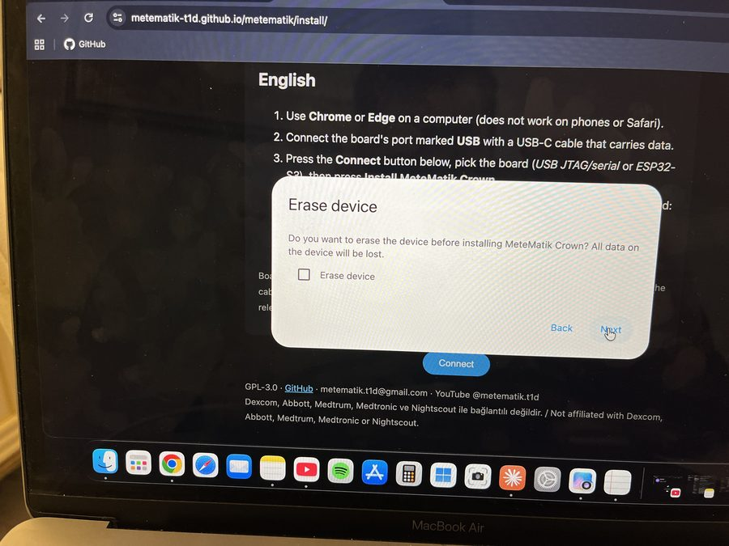 | **4.** On a first install, tick **Erase device**. For an update, leave it unticked so your settings are kept. Then confirm with **Install**. |
| 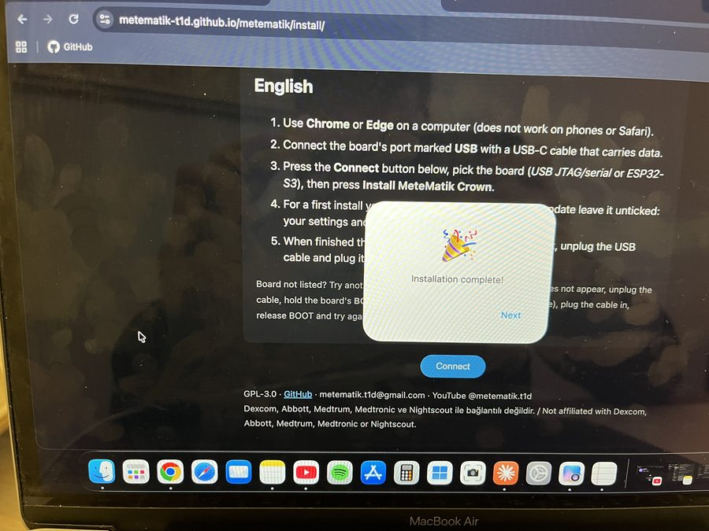 | **5.** Installing takes a few minutes. When it says **Installation complete**, the device restarts by itself. If it does not, unplug and replug the USB cable. |

## 6. First setup (with your phone)

Plug the device into a USB charger.

| | |
|---|---|
| 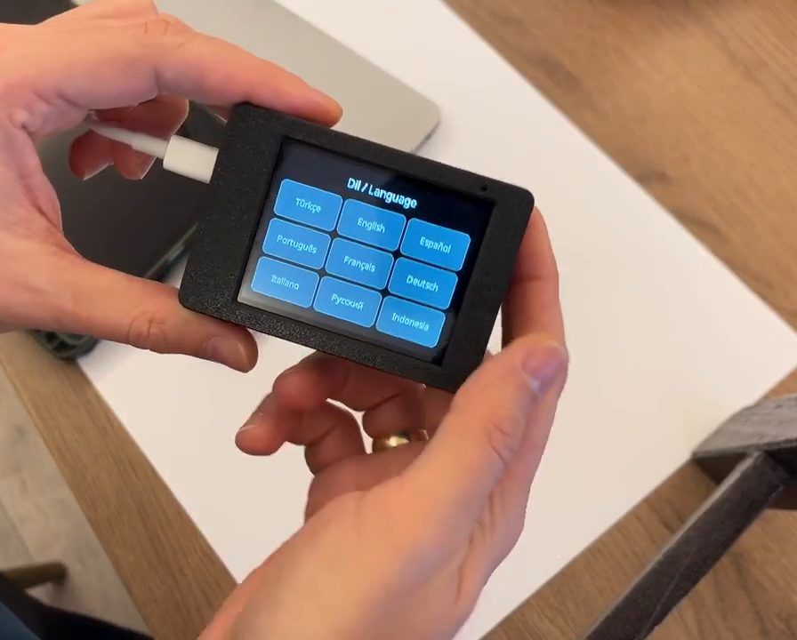 | **1.** Choose your language. |
| 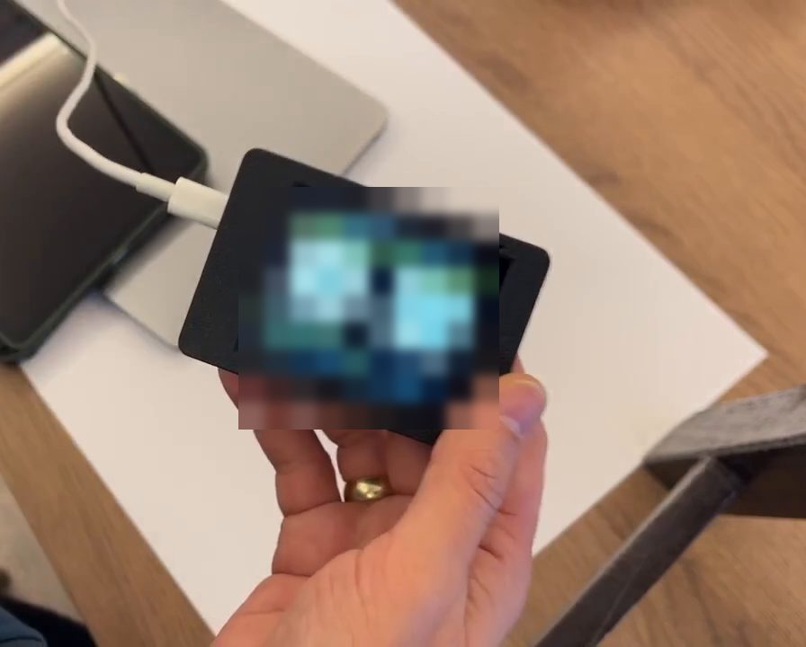 | **2.** Two QR codes appear. Scan **QR 1** with your phone's camera to join the device's setup network. If the setup page does not open by itself, scan **QR 2**. |
| 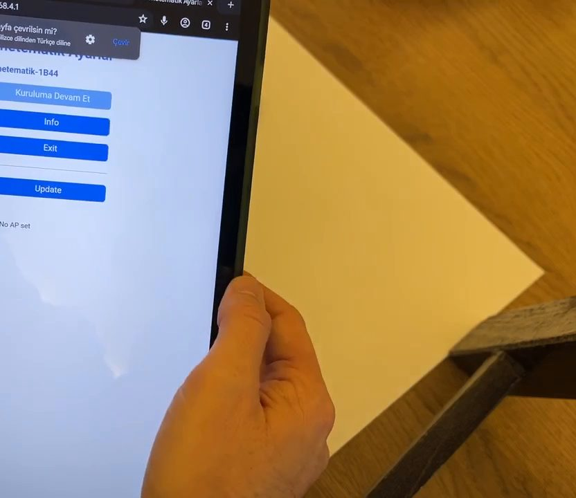 | **3.** Choose your home Wi-Fi and enter its password. Then fill in **one** data source and save. |

The device restarts, shows an important notice and then your glucose.

**Data sources** (details: [sources.md](sources.md)):

| Source | What you need |
|---|---|
| Dexcom (G6 / G7 / ONE+) | Your **own** Dexcom account that the sensor runs on (not the Follow account). **Share** must be on in the Dexcom app with at least one follower. If registered by phone, enter the number as `+<country code>…`. Server: **us** in the USA, **ous** elsewhere |
| FreeStyle Libre | A **LibreLinkUp** follower account that accepted the invitation |
| Medtrum | An **EasyFollow** follower account |
| Nightscout | Your site address (https://…) and, if needed, a read token |

About Wi-Fi: the device only connects to **2.4 GHz** networks. If you use your phone's hotspot, turn the hotspot off during setup, join the device's network and enter the details, then turn the hotspot back on.

## 7. Updating

Two ways:

- **From the install page:** repeat step 5 but **do not tick Erase device**. Your settings are kept.
- **Over Wi-Fi:** open the device's web page from a phone or computer on the same Wi-Fi (*Settings → QR / Web*) and upload the `.bin` file under *Firmware update*.

## 8. Troubleshooting

| Problem | Fix |
|---|---|
| Board not in the port list | Try another USB-C cable (one that carries data). If it still does not appear, hold BOOT with a paper clip while plugging in the cable, then release. |
| Setup page does not open | Make sure the phone is on the device's network and scan QR 2. |
| Will not join Wi-Fi | Choose a 2.4 GHz network and check the password. Holding BOOT for 2 seconds reopens Wi-Fi setup. |
| "No data" | Check the source details. Is Share on in Dexcom? Was the Libre invitation accepted? The error text on screen tells you the reason. |

Stuck? Write to **metematik.t1d@gmail.com** or open an *Issue* on GitHub.
