# MeteMatik user guide

[Türkçe → kullanim-rehberi.md](kullanim-rehberi.md) · [← Setup guide](setup-guide.md)

> ⚠️ MeteMatik is not a medical device; it is for information only. Do not use it for insulin or treatment decisions. Rely on your official CGM app and keep your CGM alarms on.

The photos below show the Turkish interface; the device also runs in English and 7 other languages.

## Home screen

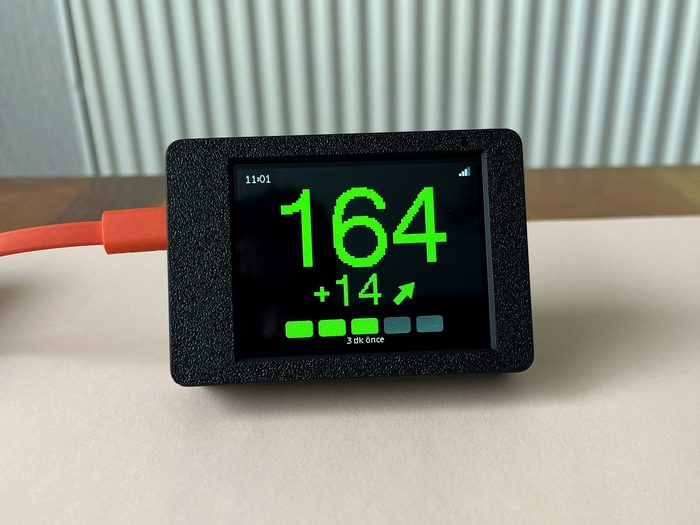

- **Big number:** latest glucose (mg/dL or mmol/L).
- **Arrow:** direction (rising, falling, steady).
- **Delta:** change over the last 5 minutes. A `*` means there was a data gap and the change was scaled to 5 minutes as an estimate. `--` means a gap of more than 15 minutes, so the change is unknown.
- **Bars at the bottom:** how many minutes ago the reading arrived.

## Getting around

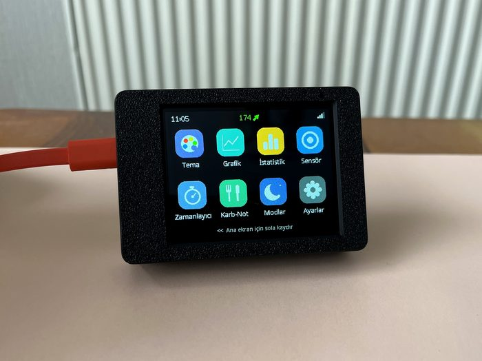

- **Swipe left** on the home screen: the apps open.
- **Swipe right** or short-press **BOOT**: back.
- Apps: **Theme, Graph, Statistics, Sensor, Timer, Carb notes, Modes, Settings**.
- Scroll lists with your finger and tap to open. After changing a setting, press **Save** at the top right. If you press *Back* without saving, the device asks.
- Tap the **(i)** sign to see what a feature does.

## Themes

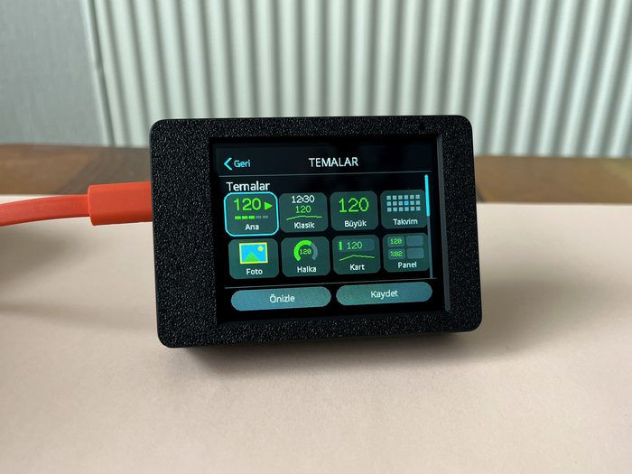 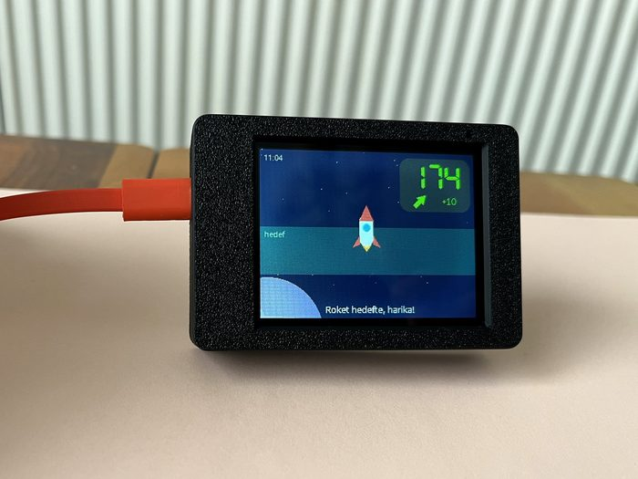

- Choose the look of the home screen in the **Theme** app: big numbers, clock, calendar, and kids' themes such as rocket, balloon, fish and smiley.
- Shortcut: **press and hold** on the home screen to open the theme picker.
- *Settings → Edit pages*: the features you turn on (2nd theme, graph, statistics, sensor…) become extra pages next to the home screen; swipe between them. Press and hold on page 2 or 3 to change that page's theme.

## Graph, statistics, sensor

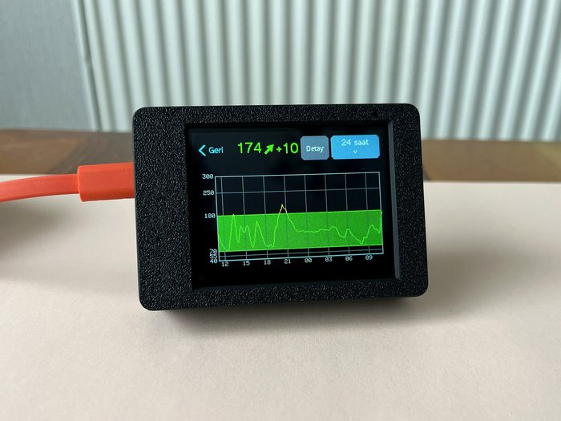 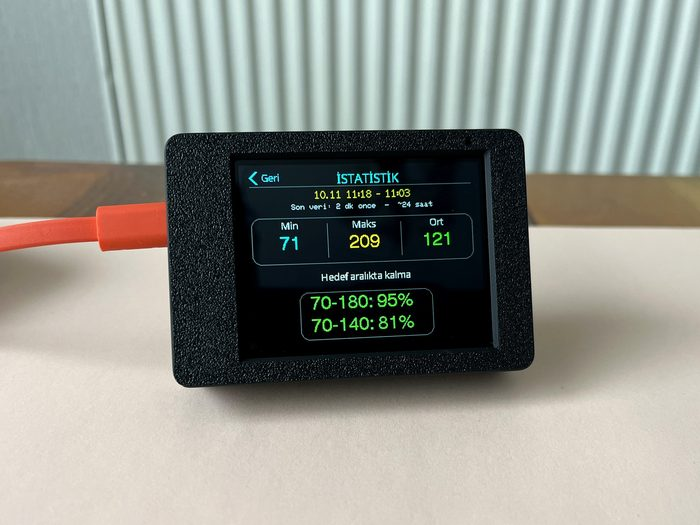 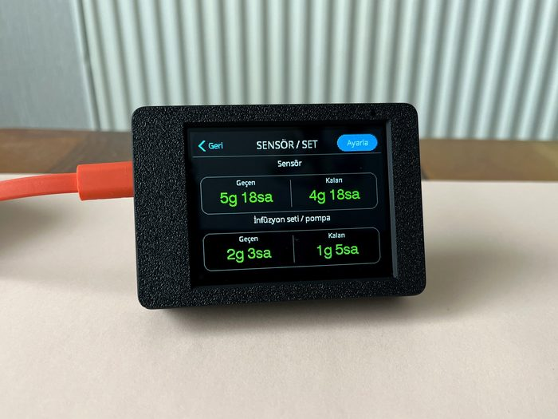

- **Graph:** last 3 / 6 / 12 / 24 hours.
- **Statistics:** lowest, highest, average and time in range.
- **Sensor:** how long the sensor and the infusion set have been in. A short reminder appears 12 h, 3 h, 1 h and 15 min before they expire. With Dexcom or Libre, enter the insertion time here. Without a pump, you can turn set tracking off.

## Alarms

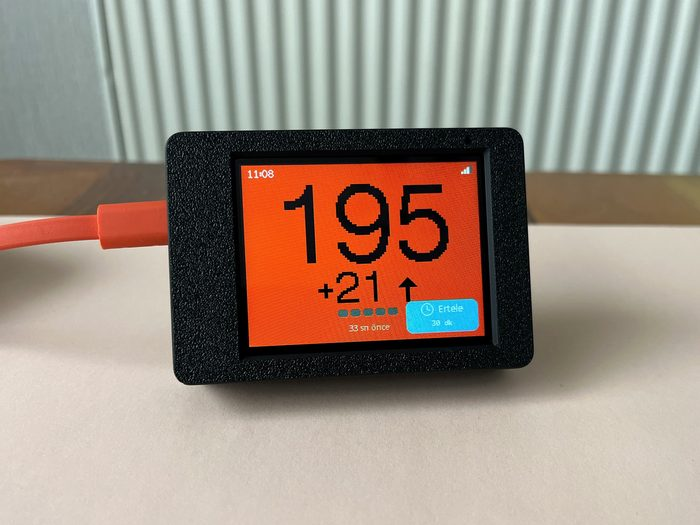

- *Settings → Targets:* critical low, low, high and very high limits and their sounds.
- *Settings → Alarms:* fast fall/rise (double arrow) alarm, no-data alarm, visual (blinking) alarm and snooze time.
- When an alarm sounds, press **Snooze**: it stays quiet for 15, 30 or 60 minutes.
- The double-arrow alarm works with Nightscout and Dexcom only; LibreLinkUp does not report double arrows.

## Modes

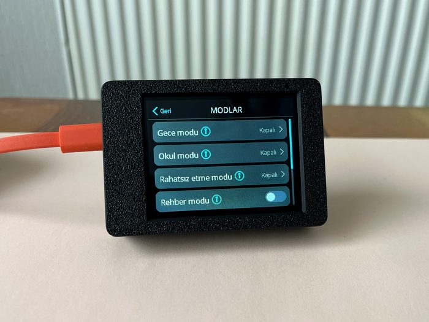

- **Night mode / School mode:** sound and brightness change automatically at the hours you choose. Tap the time to type the hours you want.
- **Do not disturb:** the screen turns off while glucose is in range. It wakes on an alarm or a finger snap.
- **Guide mode** (off by default): when glucose enters a dangerous range, an **Alert** button appears on the home screen. Whoever presses it (teacher, carer, relative) is shown what to do, step by step.

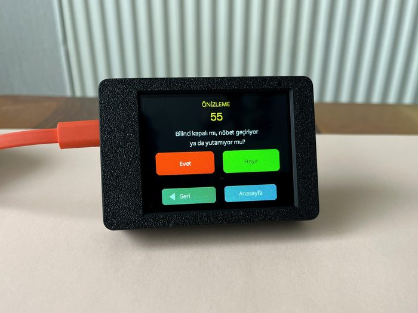 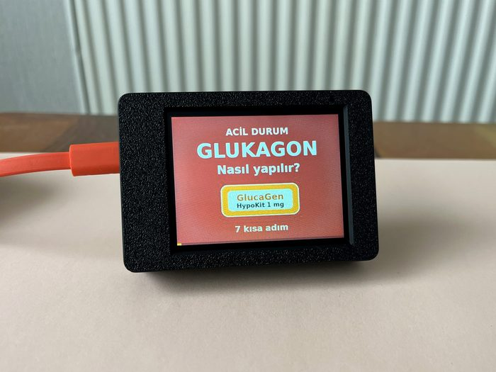

The Guide mode steps and the glucagon video were reviewed by a diabetes nurse. They do not replace your doctor's instructions.

## Family mode (up to 3 people)

1. Open the device's web page on your phone (*Settings → QR / Web*, scan the QR).
2. Turn on the **Family mode** card, choose 2 or 3 people and enter their names.
3. Select each person at the top of the page and enter their data source and limits.
4. On the device: *Modes → Family mode*. The home screen shows people **in turn** (15 s each) or **split** (all together).

Tap the name in the title to switch person. The person in alarm comes to the screen by itself.

## Settings from your phone

With a phone on the same Wi-Fi, scan the QR in *Settings → QR / Web*. You can change all settings, the data source and family mode there. The page is protected by the password shown on the device; do not share it.

## Display and language

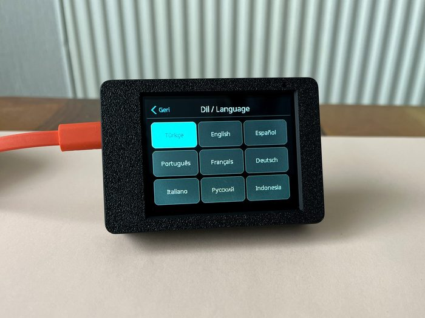

*Settings → Display/Language:* screen rotation, **Color friendly mode** (for color blindness) and language: Türkçe, English, Español, Português, Français, Deutsch, Italiano, Русский, Bahasa Indonesia.

## Good to know

- **Holding BOOT for 2 seconds** reopens Wi-Fi and source setup.
- The device sends your data nowhere. It only connects to the CGM source you choose.
- Updating: [setup guide, step 7](setup-guide.md#7-updating).
